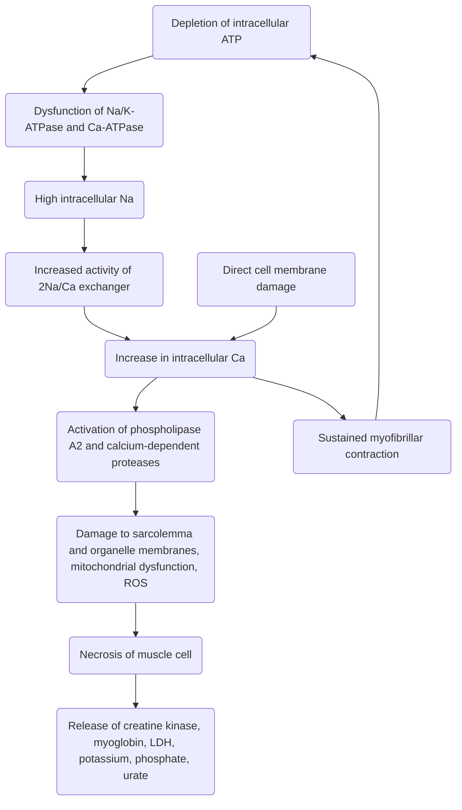
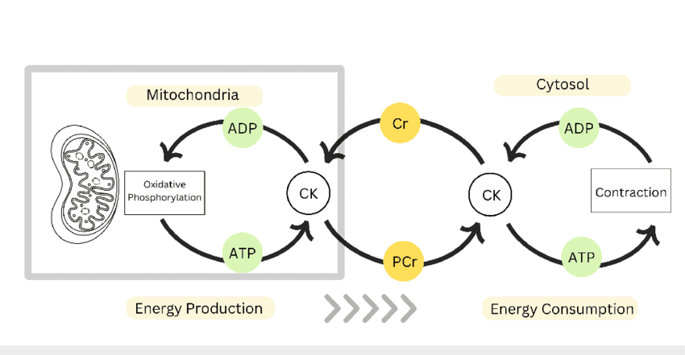
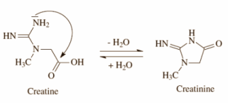
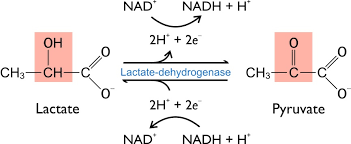

# Rhabdomyolysis

## Definition

- Skeletal muscle necrosis with release of intracellular contents (CK, myoglobin, LDH, potassium, phosphate, urate) into the circulation.
- Laboratory definition varies; most commonly **CK >5× upper limit of normal or >1000 IU/L** in the right clinical context (Kodadek et al., AAST Critical Care Committee Clinical Consensus Document, 2021).

## Etiology

Often multifactorial; drugs, toxins, and alcohol are the most common causes in hospitalized adults (Grover and Sripathi, Muscle & Nerve, 2026).

**Physical**

- Crush injury, prolonged immobilization, compartment syndrome
- Burns, electrical injury
- Heavy or unaccustomed exertion, seizures, severe agitation
- Hypothermia
- Hyperthermia: heat stroke (especially exertional), neuroleptic malignant syndrome, malignant hyperthermia, serotonin syndrome
- Ischemia: arterial occlusion, carbon monoxide

**Chemical**

- Statins (risk rises with fibrates, cyclosporine, macrolides, niacin)
- Anticholinergic drugs
- Phenothiazines and other antipsychotics
- Salicylates
- Others: propofol, colchicine, succinylcholine, zidovudine
- Electrolytes: hypo- or hypernatremia, hypokalemia, hypocalcemia, hypophosphatemia
- Cocaine, heroin, amphetamines, phencyclidine
- Alcohol, alcohol withdrawal

**Biological**

- Insect stings (hornets, wasps), snake venom
- Infection: influenza, Epstein-Barr virus; bacterial (Streptococcus pyogenes, Staphylococcus aureus)
- Genetic: glycogen storage diseases (e.g., McArdle disease), fatty acid oxidation defects (e.g., CPT II deficiency), mitochondrial disorders, RYR1 variants, muscular dystrophies, lipin-1 deficiency
- Autoimmune: idiopathic inflammatory myopathies (dermatomyositis, polymyositis, immune-mediated necrotizing myopathy)
- Endocrine: hypothyroidism, hyperthyroidism, adrenal insufficiency, diabetic ketoacidosis, hyperosmolar state, hyperaldosteronism

(Grover and Sripathi, Muscle & Nerve, 2026; Kodadek et al., AAST Clinical Consensus Document, 2021)

## Pathophysiology

Two entry points (energy depletion or direct sarcolemmal injury) converge on a rise in intracellular calcium (Chavez et al., Critical Care, 2016; Grover and Sripathi, Muscle & Nerve, 2026).

- Sustained contraction and continuous calcium pumping consume more ATP, creating a self-reinforcing loop.
- Necrosis triggers inflammation and capillary leak, with third-spacing of fluid into injured muscle.

## Complications

AKI is the most common systemic complication and drives most of the morbidity and mortality (Kodadek et al., AAST Clinical Consensus Document, 2021).

#### Acute kidney injury

- First described in crush victims of the London air raids ([BMJ, 22 March 1941](https://doi.org/10.1136/bmj.1.4185.427)).
- Reported incidence 13–50% (Petejova and Martinek, Critical Care, 2014).
- **Hypovolemia**: fluid sequestration in damaged muscle activates the renin-angiotensin system, sympathetic nervous system, and ADH, causing renal vasoconstriction.
- **Myoglobin**:
    - Bound to plasma proteins at low concentrations; appears free in plasma and is freely filtered once binding capacity is exceeded.
    - In acidic urine, precipitates with Tamm-Horsfall protein to form pigmented casts and tubular obstruction.
    - Contributes to renal vasoconstriction.
- **Heme / ferrihemate**: free-radical generation and lipid peroxidation cause direct proximal tubular injury.
- Net mechanism: vasoconstriction + oxidant injury + tubular obstruction (Bosch et al., New England Journal of Medicine, 2009; Kodadek et al., AAST Clinical Consensus Document, 2021).
- Predictors of AKI beyond CK: elevated baseline creatinine, volume depletion, hypocalcemia, hyperphosphatemia, low serum bicarbonate, sepsis (Grover and Sripathi, Muscle & Nerve, 2026; Bosch et al., New England Journal of Medicine, 2009). The McMahon score combines these to predict RRT or death (Richert et al., Chest, 2026).

#### Electrolyte and acid-base disturbances

- Hyperkalemia (release from muscle plus reduced clearance); the most immediately life-threatening.
- Metabolic acidosis (lactic acid), hyperuricemia.
- Hyperphosphatemia.
- **Early hypocalcemia**: calcium entry into damaged cells and calcium-phosphate deposition in necrotic muscle. **Do not treat unless symptomatic or severe hyperkalemia is present**, because supplemented calcium deposits in injured muscle.
- **Late hypercalcemia** (recovery phase): release of calcium from injured muscle, with contributions from PTH and 1,25-dihydroxyvitamin D during renal recovery.

(Kodadek et al., AAST Clinical Consensus Document, 2021; Llach et al., New England Journal of Medicine, 1981)

#### Liver injury

- Aminotransferase elevation is common but largely reflects muscle origin (AST and ALT are both present in skeletal muscle).
- True hepatic dysfunction may occur in severe cases; oxidative stress is a proposed mechanism (Lim, World Journal of Gastroenterology, 2020; Martinez et al., Anesthesia & Analgesia, 2023).

#### Compartment syndrome

- Muscle swelling and edema within tight fascia; both a cause and a consequence. Fasciotomy when indicated.

#### Disseminated intravascular coagulation

- Usually late; release of thromboplastin and other prothrombotic intracellular contents (Grover and Sripathi, Muscle & Nerve, 2026).

## Biomarkers

#### Creatine kinase

- Phosphocreatine (PCr, also called creatine phosphate) is an energy reservoir that regenerates ATP on demand.
- Mitochondrial CK: generates PCr from mitochondrial ATP and creatine imported from the cytosol.
- Cytosolic CK: regenerates ATP from PCr at sites of use.

- Phosphocreatine-creatine shuttle

- Both creatine and phosphocreatine convert to creatinine through an irreversible, non-enzymatic cyclization (dehydration of creatine; loss of phosphate from PCr).

In rhabdomyolysis:

- **Kinetics**: rises within 2–12 h of injury, peaks at 24–72 h (some series report up to 3–5 days), and normalizes over roughly 3–10 days once injury stops (Kodadek et al., AAST Clinical Consensus Document, 2021; Grover and Sripathi, Muscle & Nerve, 2026; Chavez et al., Critical Care, 2016).
- CK-MM is the isoenzyme most reflective of skeletal muscle injury.
- Follow serial CK until a peak is identified and the trend is reliably downward.
- **CK and AKI risk**: CK >5000 U/L is the conventional threshold for starting renal-protective fluids, but there is no defined CK value above which AKI risk rises sharply. Risk is usually low when admission CK is <15,000–20,000 U/L; AKI at values near 5000 U/L usually occurs with coexisting sepsis, dehydration, or acidosis (Bosch et al., New England Journal of Medicine, 2009). Initial CK was a weak predictor of AKI in more recent cohorts (Vangstad et al., Emergency Medicine Journal, 2026).

#### Myoglobin

- Transports oxygen from the sarcolemma to the mitochondria.
- Rises and peaks before CK; half-life is short (about 1–4 h), so levels may normalize before CK does. This limits its sensitivity for diagnosis (Kodadek et al., AAST Clinical Consensus Document, 2021; Bosch et al., New England Journal of Medicine, 2009).
- Urine dipstick positive for blood with few or no red cells on microscopy suggests myoglobinuria.
- AKI prediction (thresholds vary by cohort; ng/mL = μg/L):
    - Serum myoglobin ≥1000 ng/mL predicted AKI and 90-day mortality better than CK in exertional heat stroke ([Wu et al., International Journal of Hyperthermia, 2022](https://doi.org/10.1080/02656736.2022.2046183)).
    - Admission myoglobin outperformed CK after major trauma; best cutoff 1217 μg/L for stage 2–3 AKI (Tarazona et al., Annals of Intensive Care, 2021).
    - Prospective cohort: myoglobin-to-CK ratio was the strongest admission predictor (AUC 0.84) versus myoglobin (0.73) and CK (0.31); cutoffs of ratio ≥0.48 and myoglobin ≥4489 ng/mL (Vangstad et al., Emergency Medicine Journal, 2026).
    - Myoglobin >15 mg/L was highly associated with AKI in an earlier cohort (Chavez et al., Critical Care, 2016).
    - Myoglobin-AKI above 3865 μg/L [verify source].
- Overall: probably a better predictor of AKI than CK, but values overlap and no single threshold is validated.

#### LDH

- Released from necrotic muscle; elevated but nonspecific.

#### ALT/AST

- Both rise in proportion to CK (AST more than ALT) and cannot distinguish muscle from liver injury (Laitselart et al., Injury, 2022; Lim et al., Journal of Clinical Medicine, 2019).
- In the absence of CK testing, AST ≥110 U/L predicts CK ≥5000 U/L [verify source].

## Management

Treat the cause and stop the injury: discontinue myotoxic drugs, control seizures and agitation, cool hyperthermia, decompress compartment syndrome.

#### Fluid resuscitation

- The cornerstone of therapy; start early (ideally within 6 h of muscle injury) (Chavez et al., Critical Care, 2016).
- **Fluid type**: lactated Ringer's or saline (0.9% or 0.45%) are both acceptable; no trial shows superiority.
- **Rate**: start at about 400 mL/h (range 200–1000 mL/h) and titrate to urine output.
- **Urine output goal**: 1–3 mL/kg/h, up to 300 mL/h (other sources use 200 mL/h).
- Crush injury: isotonic saline 1 L/h for the first 2 h, then 500 mL/h has been suggested (Chavez et al., Critical Care, 2016).
- Reported first-24-h volumes of 3–24 L and urine output targets of 2–12 L [verify source].
- **Endpoint**: continue until CK is reliably downtrending; CK <5000 U/L is a commonly used stopping point.
- Watch for volume overload. If the patient remains oliguric or anuric despite escalating fluids, stop escalating and consider RRT.
- Monitor potassium, calcium, phosphate, bicarbonate, creatinine, and CK serially.

(Kodadek et al., AAST Clinical Consensus Document, 2021; Grover and Sripathi, Muscle & Nerve, 2026)

#### Adjuncts with unproven benefit

- **Sodium bicarbonate**
    - Rationale: alkaline urine reduces myoglobin-Tamm-Horsfall precipitation and heme redox cycling.
    - No strong clinical evidence that it prevents AKI; the AAST consensus document discourages routine use (Kodadek et al., AAST Clinical Consensus Document, 2021).
    - Some authors consider it reasonable alongside saline, especially with metabolic acidosis. If used, monitor urine pH, serum bicarbonate, calcium, and potassium; stop if urine pH does not rise after 4–6 h or symptomatic hypocalcemia develops (Bosch et al., New England Journal of Medicine, 2009).
    - Suggested selective criteria: isotonic sodium bicarbonate (15 mmol/100 mL) when urine pH <6, CK >30,000 U/L, or severe metabolic acidosis and hyperkalemia are present; stop when urine pH >7 [verify source].
    - Risk: worsens hypocalcemia.
- **Mannitol**
    - Rationale: osmotic diuresis, extraction of fluid from edematous muscle, free-radical scavenging.
    - No randomized trial supports it. Use only after volume repletion; contraindicated in anuria.
    - Doses >200 g/day or cumulative >800 g are associated with AKI (osmotic nephrosis). Monitor the osmolal gap and stop if it exceeds 55 mOsm/kg or diuresis is inadequate (Bosch et al., New England Journal of Medicine, 2009).
- **Loop diuretics**: evidence is sparse; may acidify urine and promote cast formation. Reserve for volume overload (Kodadek et al., AAST Clinical Consensus Document, 2021).

#### Renal replacement therapy

- Indications are the standard ones for AKI: refractory hyperkalemia, severe metabolic acidosis, volume overload, uremia, or persistent oliguria/anuria despite resuscitation. No CK or myoglobin threshold should trigger RRT (Meersch-Dini et al., Critical Care, 2026; Petejova and Martinek, Critical Care, 2014).
- **No evidence of benefit from prophylactic RRT**: adding CVVHDF to standard therapy increased myoglobin removal but did not improve renal outcomes and raised costs (Meng et al., BMC Nephrology, 2023).
- **Myoglobin clearance** (about 17 kDa):
    - Poorly cleared by standard diffusive dialysis.
    - Convective modalities (hemofiltration, hemodiafiltration) and high or medium cut-off dialyzers clear it better. In a randomized trial, CVVHD with a high cut-off dialyzer cleared more myoglobin than CVVHDF with a high-flux dialyzer (Weidhase et al., Critical Care, 2020).
    - Improved clearance has not translated into better clinical outcomes; high cut-off membranes also lose albumin and coagulation factors (Meersch-Dini et al., Critical Care, 2026; Forni et al., BMC Nephrology, 2024).
    - Hemoadsorption is under investigation.
- Functioning kidneys remove more myoglobin than any extracorporeal circuit, so preserving diuresis comes first (Weidhase et al., Critical Care, 2020).

## To read

- Cruz DN, Bagshaw SM. Does continuous renal replacement therapy have a role in the treatment of rhabdomyolysis complicated by acute kidney injury? Seminars in Dialysis. 2011;24(4):417.
- Somagutta MR, et al. Role of bicarbonates and mannitol in rhabdomyolysis: a comprehensive review. Cureus. 2020;12(8).